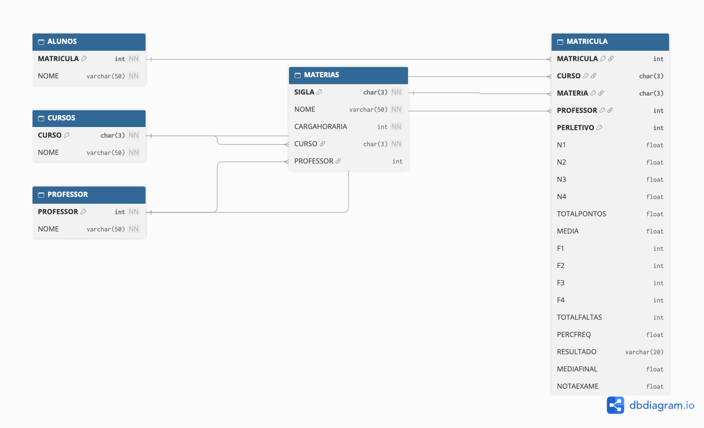

# Universidade – Stored Procedures (SQL Server)

Trabalho da disciplina de **Banco de Dados** sobre *Stored Procedures* em T-SQL.
Enunciado: [Linguagem SQL (II) – Exercício Procedure](https://mestredornel.com.br/exercicios-procedure/)

O objetivo é modelar um banco para guardar os dados dos alunos de uma universidade e criar as procedures que:

1. **Matriculam o aluno automaticamente** em todas as matérias do curso escolhido;
2. **Lançam notas e faltas** por bimestre e, ao final do 4º bimestre, **apuram o resultado** (aprovado, reprovado ou exame);
3. **Lançam a nota do exame** e **reprocessam o resultado** do aluno que ficou em exame.

---

## Tecnologias

- **SQL Server 2022** rodando em Docker
- **T-SQL** (procedures, `THROW`, `INSERT ... SELECT`, `SCOPE_IDENTITY()`)
- **VS Code** com a extensão *SQL Server (mssql)*
- **Python + Streamlit** para um painel de testes (opcional)
- **dbdiagram.io** para o diagrama

## Estrutura do repositório

| Arquivo | Conteúdo |
|---|---|
| `01_criacao.sql` | Script base do professor: cria o banco, as tabelas e os dados iniciais |
| `02_populacao.sql` | Dados extras para teste: mais cursos, professores e matérias |
| `02_verificacao.sql` | Consultas rápidas para conferir os dados |
| `03_procedures.sql` | As três procedures do trabalho |
| `04_testes.sql` | Roteiro de testes com todos os cenários e validações |
| `app.py` | Painel em Python para executar as procedures e rodar os testes |
| `diagrama.png` | Diagrama entidade-relacionamento |

---

## Modelo de dados



| Tabela | Chave primária | Descrição |
|---|---|---|
| `ALUNOS` | `MATRICULA` (IDENTITY) | Alunos da universidade |
| `CURSOS` | `CURSO` (sigla) | Cursos oferecidos |
| `PROFESSOR` | `PROFESSOR` (IDENTITY) | Professores |
| `MATERIAS` | `SIGLA` | Matérias, com carga horária, curso e professor responsável |
| `MATRICULA` | `MATRICULA + CURSO + MATERIA + PROFESSOR + PERLETIVO` | Notas, faltas e resultado de cada aluno em cada matéria |

### Relacionamentos

- Um **curso** tem várias **matérias**; uma matéria pertence a um curso.
- Um **professor** pode dar várias **matérias**; o professor da matéria pode ficar vazio (matéria ainda sem professor definido).
- `MATRICULA` é uma **entidade associativa**: resolve o relacionamento muitos-para-muitos entre **alunos** e **matérias** e guarda os dados dessa relação (notas, faltas, resultado).

### Decisões do modelo

- **`PERLETIVO` faz parte da chave** para permitir que o aluno curse a mesma matéria em anos diferentes (por exemplo, quando é reprovado e refaz a matéria no ano seguinte).
- **`MATRICULA` guarda `CURSO` e `PROFESSOR`** mesmo eles já estando em `MATERIAS`, para preservar o **histórico**: se o professor da matéria mudar no ano seguinte, a matrícula antiga continua registrando quem deu a aula naquele ano.
- As colunas da chave primária não aceitam `NULL` (o SQL Server aplica `NOT NULL` automaticamente nas colunas da PK).

---

## Regras de negócio

### Matrícula

- Ao matricular um aluno, ele é cadastrado em `ALUNOS` e recebe automaticamente uma linha em `MATRICULA` para **cada matéria do curso**, com o professor da matéria.
- O **período letivo** é o ano atual (`YEAR(GETDATE())`).

### Lançamento de notas e faltas

- A nota vai de **0 a 10**, e o bimestre de **1 a 4**.
- Os bimestres são lançados **em ordem**: só é possível lançar o bimestre *N* se os bimestres anteriores já tiverem nota e falta.
- A cada lançamento são atualizados o **total de pontos**, o **total de faltas** e a **média parcial**.

### Apuração do resultado (4º bimestre)

```
MEDIA      = (N1 + N2 + N3 + N4) / 4
FREQUÊNCIA = (CARGAHORARIA - TOTALFALTAS) × 100 / CARGAHORARIA
```

| Condição (avaliada nesta ordem) | Resultado |
|---|---|
| Frequência < 75% | `REPROVADO POR FALTA` |
| Média ≥ 7 | `APROVADO` |
| Média ≥ 3 | `EXAME` |
| Média < 3 | `REPROVADO` |

A frequência é verificada **antes** da nota: um aluno com média 9 e frequência de 70% é reprovado por falta.

### Exame

- Só pode fazer exame o aluno com resultado **`EXAME`**. Também é aceito quem já fez o exame, para **corrigir a nota e reprocessar** o resultado.

```
MEDIAFINAL = (MEDIA + NOTAEXAME) / 2
```

| Condição | Resultado |
|---|---|
| Média final ≥ 5 | `APROVADO EM EXAME` |
| Média final < 5 | `REPROVADO EM EXAME` |

### Erros de validação

As procedures usam `THROW` com códigos próprios:

| Código | Quando acontece |
|---|---|
| `50001` | Bimestre fora do intervalo de 1 a 4 |
| `50002` | Nota (ou nota do exame) fora do intervalo de 0 a 10 |
| `50003` | Matrícula não encontrada ou bimestre anterior sem nota/falta |
| `50004` | Lançamento de exame para aluno que não está em exame |

---

## Procedures

### `procMATRICULAALUNO`

Cadastra o aluno e o matricula em todas as matérias do curso.

```sql
EXEC procMATRICULAALUNO @NOME = 'PEDRO', @CURSO = 'ENG';
```

### `sp_CadastraNotas`

Lança a nota e as faltas de um bimestre. No 4º bimestre calcula a frequência, a média final e o resultado.

```sql
EXEC sp_CadastraNotas
     @MATRICULA = 1,
     @CURSO     = 'ENG',
     @MATERIA   = 'BDA',
     @PERLETIVO = '2026',
     @NOTA      = 7.0,
     @FALTA     = 2,
     @BIMESTRE  = 1;
```

### `sp_CadastraExame`

Lança a nota do exame e reprocessa o resultado.

```sql
EXEC sp_CadastraExame
     @MATRICULA = 1,
     @CURSO     = 'ENG',
     @MATERIA   = 'BDA',
     @PERLETIVO = 2026,
     @NOTAEXAME = 6.0;
```

---

## Como executar

### 1. Subir o SQL Server no Docker

No Mac com Apple Silicon, ative no Docker Desktop a opção *Use Rosetta for x86_64/amd64 emulation*.

```bash
docker run --platform linux/amd64 -e "ACCEPT_EULA=Y" -e "MSSQL_SA_PASSWORD=<sua_senha_forte>" \
  -p 1433:1433 --name sqlserver -d mcr.microsoft.com/mssql/server:2022-latest
```

### 2. Rodar os scripts, nesta ordem

1. `01_criacao.sql`
2. `02_populacao.sql`
3. `03_procedures.sql`
4. `04_testes.sql`

Os scripts 01 e 02 rodam uma única vez em um banco novo. O 03 usa `CREATE OR ALTER` e pode ser executado quantas vezes for preciso.

Para recomeçar do zero:

```sql
USE master;
DROP DATABASE Universidade;
```

### 3. Painel de testes (opcional)

```bash
python3 -m venv .venv
.venv/bin/pip install -r requirements.txt
.venv/bin/streamlit run app.py
```

O painel abre em `http://localhost:8501`. Informe a senha do usuário `sa` na barra lateral. Ele permite:

- ver as tabelas, com o resultado colorido;
- matricular alunos, lançar notas e lançar exames pelas procedures;
- rodar todos os testes e comparar cada resultado com o esperado.

---

## Testes

O `04_testes.sql` (e a aba **Rodar testes** do painel) cobre os cenários abaixo:

| Aluno | Matéria | Notas | Faltas | Resultado esperado |
|---|---|---|---|---|
| ANA SOUZA | BDA (144h) | 8, 7, 9, 8 | 8 (94,44%) | `APROVADO` |
| BRUNO LIMA | CON (80h) | 5, 5, 5, 5 | 4 (95%) | `EXAME` → exame 4 → `REPROVADO EM EXAME` → nota corrigida para 6 → `APROVADO EM EXAME` |
| CAIO ROCHA | ALG (144h) | 2, 2, 2, 2 | 0 (100%) | `REPROVADO` |
| CAIO ROCHA | RED (80h) | 9, 9, 9, 9 | 24 (70%) | `REPROVADO POR FALTA` |

Também são testados a matrícula automática (quantidade de matérias por curso) e os seis erros de validação (`50001` a `50004`).

---

## Limitações conhecidas

Pontos observados no modelo base que ficariam como melhorias futuras:

- A chave de `MATERIAS` é só a `SIGLA`, então dois cursos não podem ter matérias com a mesma sigla.
- `sp_CadastraNotas` recebe `@PERLETIVO` como `CHAR(4)`, enquanto a coluna é `INT` (funciona por conversão implícita).
- `procMATRICULAALUNO` não valida se o curso existe e, ao final, lista as matrículas de todos os alunos.
